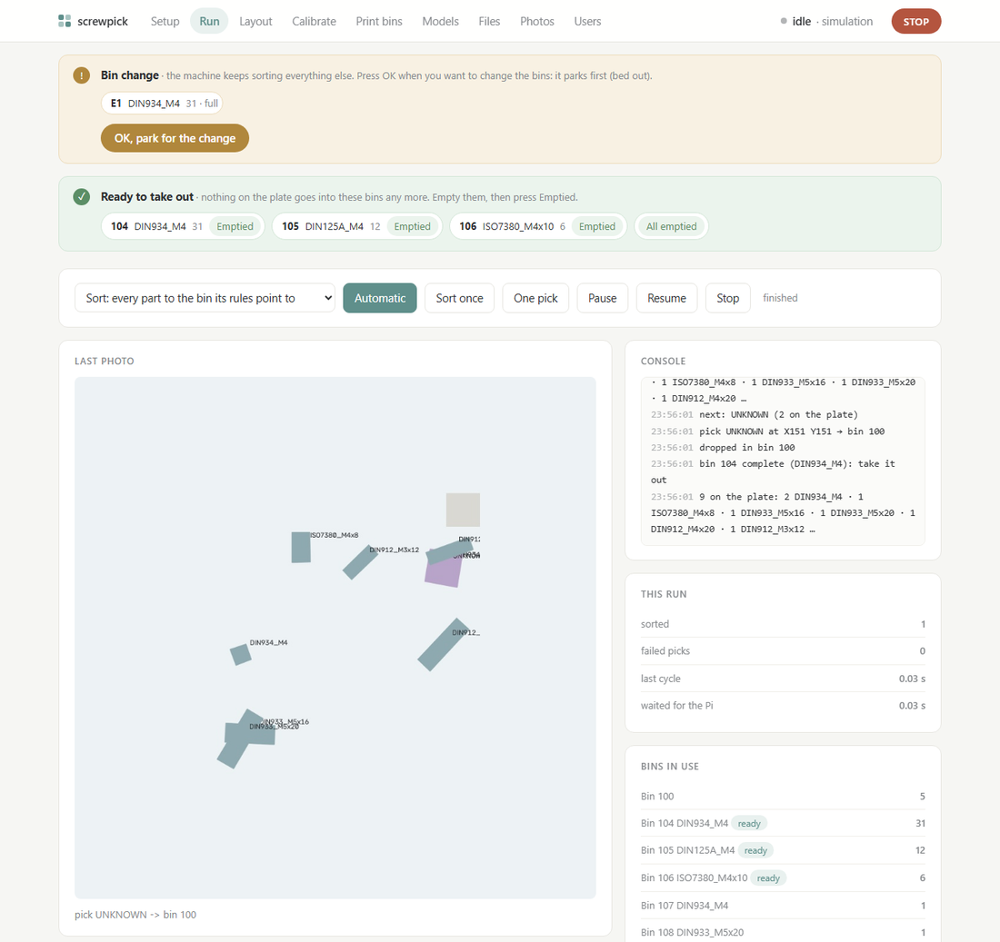
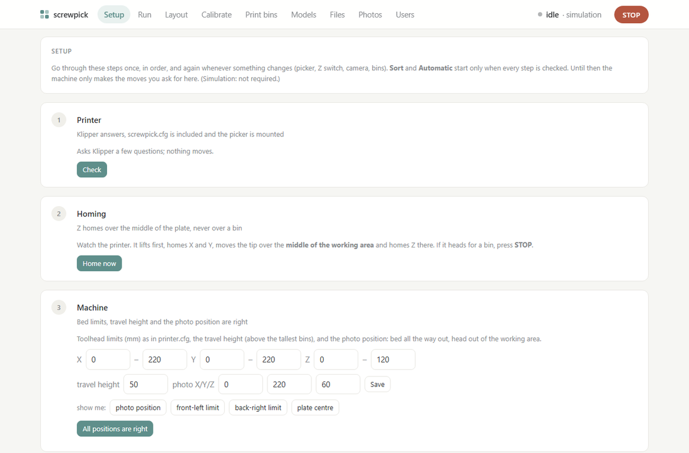
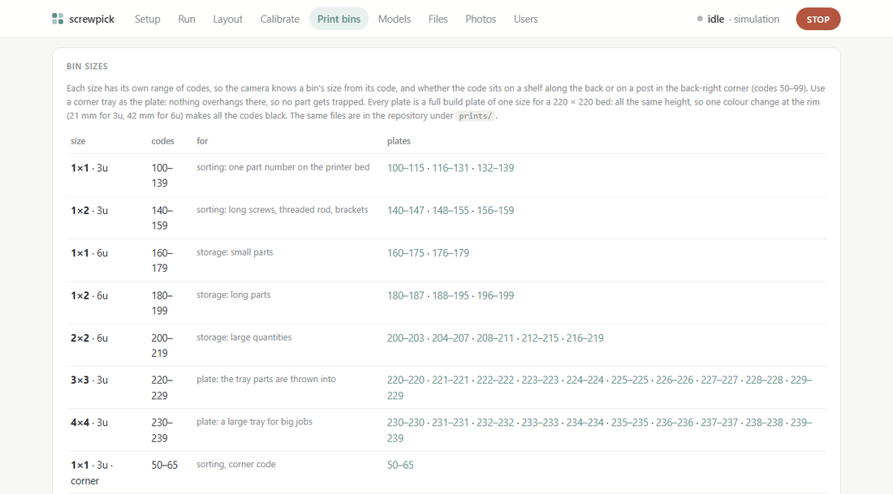
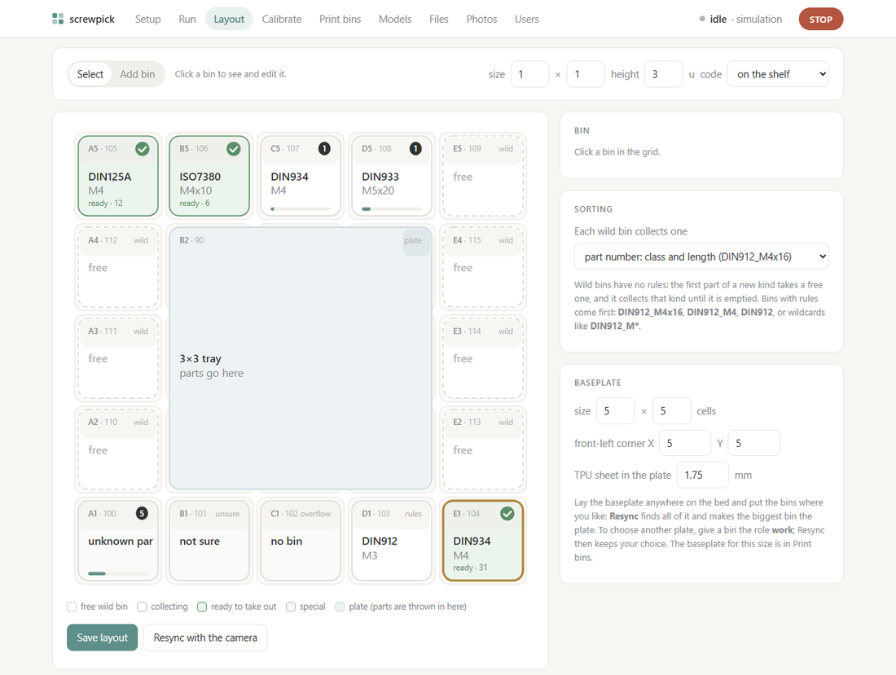
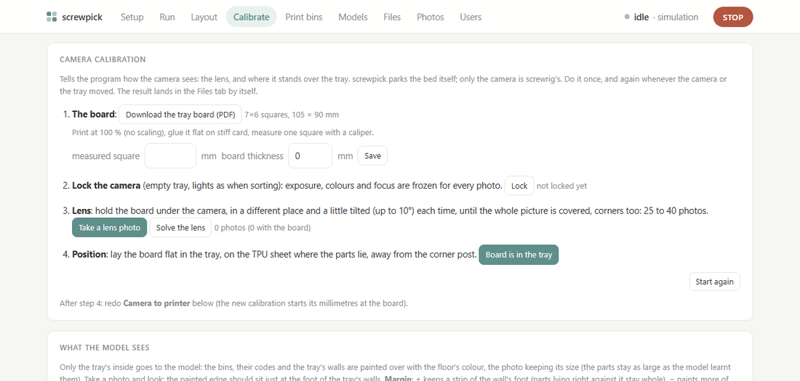
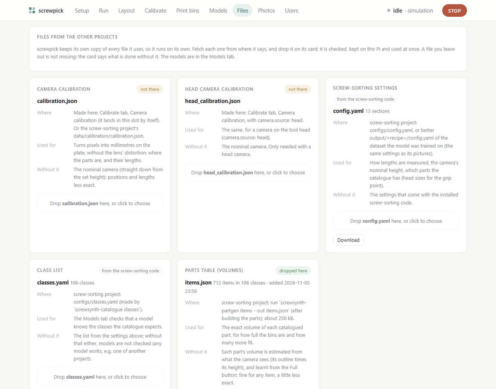
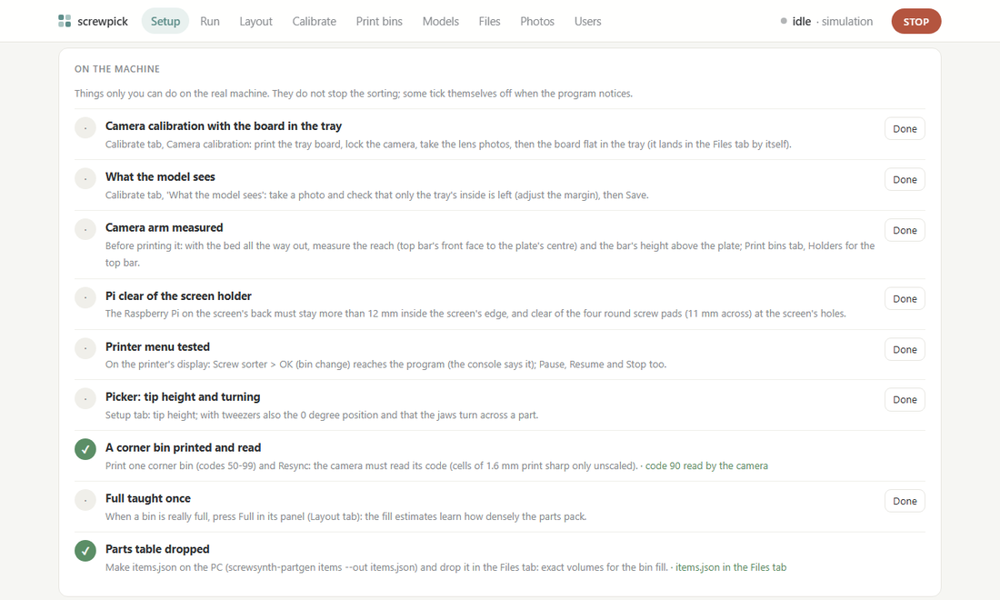
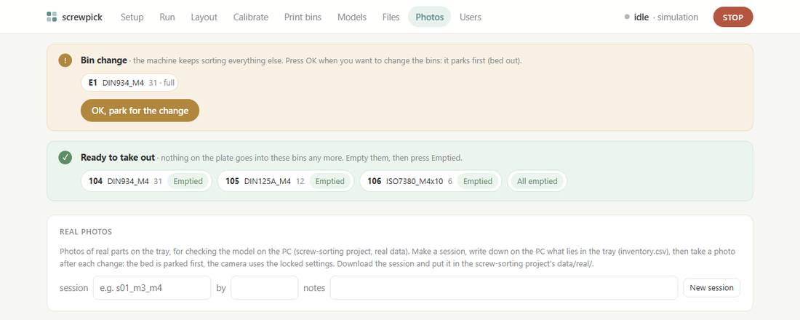

# screwpick

**Turn a 3D printer into a screw sorter.** You throw a handful of screws, nuts and washers into a
tray on the printer bed. A camera looks at them, a trained model recognises each part (type, size
and length), and the printer picks them up one by one and drops each into its own bin.

screwpick is the program that runs the machine. It lives on a Raspberry Pi next to Klipper (the
printer's firmware) and you use it from a web page on your phone or PC, or from the printer's own
display.


*The Run tab. On the left the last photo with every part outlined (here from the built-in simulator,
which draws the parts instead of photographing them); on the right the console, which says in one
line what the machine sees and decides. The banners at the top ask for a bin change and list bins
that are finished.*

It is one of three projects that work together:

| Project | Runs on | Does |
|---|---|---|
| [supreme-screw-sortering](https://github.com/ama24/supreme-screw-sortering) | your PC | makes the training pictures and measures the parts' lengths |
| [model-trainer](https://github.com/ama24/model-trainer) | your PC (GPU) | trains the model that recognises the parts |
| **screwpick** (this one) | the Raspberry Pi | runs the machine: camera, decisions, printer, bins, web page |

They only exchange files (a trained model, a calibration, a parts table), which you drop into
screwpick's web page. screwpick never reaches into the other projects' folders.

---

## Contents

- [How it works, in one minute](#how-it-works-in-one-minute)
- [What you need](#what-you-need)
- [Install](#install)
- [First-time setup](#first-time-setup)
- [Everyday use](#everyday-use)
- [How it works, in more detail](#how-it-works-in-more-detail)
- [Real photos for checking the model](#real-photos-for-checking-the-model)
- [Updating](#updating)
- [More](#more)

---

## How it works, in one minute

```
   you throw parts                  the Pi decides                   the printer moves
  ┌───────────────┐   photo    ┌──────────────────────┐  G-code  ┌───────────────────┐
  │  tray on the  │ ─────────► │  screwpick           │ ───────► │  Klipper          │
  │  printer bed, │            │  · model: what is    │ (through │  picks one part,  │
  │  bins around  │ ◄───────── │    each part, how    │ Moonraker│  drops it in its  │
  │  it           │   next     │    long              │  )       │  bin              │
  └───────────────┘   photo    │  · which bin, which  │          └───────────────────┘
                               │    part first        │
                               └──────────────────────┘
                                          ▲
                          you: web page or printer display
```

1. **The bed.** A grid of [Gridfinity](https://gridfinity.xyz/) bins sits on the bed. One big bin,
   the **tray**, is where you throw the parts; the small bins around it receive the sorted parts.
   Every bin carries a small black-and-white code, so the camera finds the bins by itself, wherever
   you put them.
2. **A photo.** The camera above the bed takes a picture. Only the inside of the tray is shown to
   the model, so the bins around it can't confuse it.
3. **Recognising.** The model outlines every part and names it (for example `DIN912_M4`, a socket
   head screw M4). For screws it also measures the length (`DIN912_M4x16`).
4. **Deciding.** screwpick counts what is in the tray and starts with the most numerous kind. Each
   kind goes to the bin you assigned it, or claims a free bin by itself.
5. **Picking.** The printer moves the picker (tweezers, a gripper or a small suction cup) over the
   part, at the right angle, takes it and drops it into its bin. While it carries the part, the Pi
   already looks at the next photo.
6. **Again**, until the tray is empty. Bins that are full or finished are shown on the page and on
   the printer display; you empty them and press OK.

---

## What you need

**Hardware**

- A **3D printer running Klipper** with Moonraker (e.g. an Ender 3 or a Prusa MK3 with MainsailOS
  or a KIAUH install). The hotend comes off; a **picker** goes on in its place: tweezers turned by
  a motor, a small servo gripper, or a suction cup on a little pump.
- A **Raspberry Pi 4 or 5** with 4 GB or more, running 64-bit Raspberry Pi OS. It runs Klipper,
  the camera, the model and the web page together.
- A **Raspberry Pi Camera Module 3** about 300 mm above the bed, looking straight down.
- Even **lighting** over the bed (an LED strip under a simple shroud works well).
- A **matte TPU sheet** (blue or green), cut to the tray's floor: parts don't bounce on it and the
  camera sees them clearly.

**Printed parts** (all ready in [prints/](prints/), or made for your own layout in the page's
*Print bins* tab):

- a Gridfinity **baseplate** for the bed (thin versions that clamp to a whole Ender 3 or MK3 bed),
- the **tray** (3 × 3 or 4 × 4 cells) and **bins**, with their codes,
- a **camera arm** and a **screen holder** for the printer's top bar (for the Pi with a 7"
  screen).

See [prints/README.md](prints/README.md) for which files to print and how.

---

## Install

### Try it on a PC first

You don't need a printer to see how it works. On any PC with Python 3.10 or newer:

```bash
git clone https://github.com/ama24/screwpick.git
cd screwpick
pip install -e ".[dev]" opencv-python   # OpenCV draws the simulated photos
screwpick serve --sim
```

Open the address it prints. Everything works with a simulated printer, camera and parts: give bins
rules, press **Sort once** and watch them get sorted.

### On the Raspberry Pi

1. **Install Klipper and Moonraker** the usual way (MainsailOS, or KIAUH on Raspberry Pi OS), and
   make sure the printer works from Mainsail.
2. **Install screwpick:**

   ```bash
   git clone https://github.com/ama24/screwpick.git ~/screwpick
   ~/screwpick/install-pi.sh --service
   ```

   The script installs everything in one go, with **exact, checked versions** of every package and
   of the screw-sorting code, so an install today and one next year give the same program.
   `--service` starts screwpick at every boot.
3. **Tell Klipper about the sorter:**

   ```bash
   cp ~/screwpick/klipper/screwpick.cfg ~/printer_data/config/
   echo "[include screwpick.cfg]" >> ~/printer_data/config/printer.cfg
   ```

   Open `screwpick.cfg` in Mainsail and adapt the *PICKER HARDWARE* part to how your picker is
   wired (examples for a pump, a servo gripper and rotating tweezers are in the file). Then restart
   Klipper.
4. **Open the page:** `http://<your-pi>:8080` on your phone or PC. The first visit asks you to
   create an account.

From now on **screwpick is the only program that moves the printer**. Even the camera calibration
photos are taken from its page.

---

## First-time setup

Until the setup is complete, the machine only makes the moves you ask for on the Setup tab;
**Sort** and **Automatic** stay locked.

### 1. The Setup tab



Go through the seven steps once, in order:

1. **Printer:** screwpick asks Klipper a few questions (is the picker mounted, is the hotend cold).
   Nothing moves.
2. **Homing:** press *Home now* and watch. screwpick lifts the head first, then homes Z over the
   middle of the tray, never over a bin.
3. **Machine:** the bed limits, the travel height and the **photo position** (bed all the way out,
   head out of the picture). *Show me* drives to each so you can check.
4. **Tip height:** jog the picker tip down onto the plate until a sheet of paper just drags, then
   press the button. Every height screwpick uses counts from here.
5. **Picker:** try *Grab* and *Release*.
6. **Camera to printer:** see step 3 below.
7. **Layout:** see step 2 below.

A step un-checks itself when something it depends on changes, so the setup can't silently go
stale.

### 2. Bins on the bed



Print the baseplate, a tray and some bins (the *Print bins* tab, or the ready-made files in
`prints/`). Bins come as two-colour files: white bin, black code. With a single-colour printer, add
a colour change at the rim height.

Put the baseplate anywhere on the bed, the tray and the bins anywhere on it, turned any way. Then
in the **Layout** tab press **Resync with the camera**: one photo finds the grid, every bin and
which way it faces, and makes the biggest bin the tray.



Each bin shows its grid name (A1 is front-left), its code, what it collects, how many parts went
in and a bar for how full it is. Click a bin to give it rules, or leave it **wild**: a wild bin is
claimed by the first new kind of part that needs a bin. A layout of only wild bins sorts by itself.

### 3. The camera



In the **Calibrate** tab:

1. **Camera calibration** teaches the program how the camera sees. Download the small tray board,
   print it, then follow the four steps: measure a square, lock the camera, take 25 to 40 photos
   of the board held at different places and angles, and finally lay it flat in the tray. The
   result is saved by itself.
2. **What the model sees:** take a photo and check that only the tray's inside is left; adjust the
   margin if a bit of the tray's wall shows.
3. **Camera to printer:** take a photo, jog the tip onto the centre of three codes, press *Tip is
   here* on each, then *Fit*. Now the program knows where every pixel is on the printer.

### 4. The model and the files

Upload the trained model in the **Models** tab (drag the file onto the page; old models are kept,
so you can switch back). The **Files** tab takes the other files screwpick can use. Each card says
where to find the file, what it's for and what happens without it:



None of them is required: without a parts table, for example, bin fill is estimated from what the
camera sees.

### 5. The last checks on the real machine

The Setup tab ends with a list of things only you can do on the real machine (measure for the
camera arm, test the printer menu, print a corner bin…). Some tick themselves off when the
program notices; they never block sorting.



---

## Everyday use

1. **Throw the parts into the tray** and spread them a little with your hand.
2. Press **Automatic** on the Run tab (or *Screw sorter → Automatic* on the printer's display).
   The machine waits until nothing moves any more, sorts until the tray is empty, then waits
   again: just keep throwing parts in. It looks again every minute, with the motors off so it's
   quiet. **Sort once** sorts what's there and stops.
3. **Watch the Run tab** if you like: the photo, the console, the counts.
4. **When a bin is full**, or a new kind needs a bin and none is free, a banner asks for a bin
   change and the bin is outlined in amber. The machine **keeps sorting everything else**.
   - Press **OK** once: the machine parks with the bed out, so your hands are safe.
   - Empty the bin, or put an empty bin in its place, and press **OK** again. A photo checks what
     is there now (the same bin emptied, another bin, or nothing) and sorting goes on.
5. **Finished bins** (nothing left in the tray goes there) are shown in green. Take them out,
   empty them and press **Emptied**.
6. **STOP** at the top right stops the printer at once.

Everything on the page can also be done from the printer's display: **Screw sorter** in its
menu has Automatic, Sort, One pick, OK, Pause, Resume and Stop.

---

## How it works, in more detail

**Seeing.** The camera photographs the whole bed. The bin codes are read from that photo. Then
everything outside the tray's inside is painted over with the tray floor's colour, and only that
goes to the model: it was trained on pictures of parts on a plain plate, at a fixed size per
millimetre, and the photo keeps exactly that size. The camera calibration turns pixels into
millimetres; the camera-to-printer fit turns those into printer coordinates.

**Choosing what to pick.** The first photo of a batch counts the parts by kind. The most numerous
kind goes first and is finished before the next one starts. If a kind that was already done turns
up again (dug out from under others), the machine goes back to it first. Within a kind, a part
with free space around it comes first, so the picker doesn't knock the others.

**Choosing the bin.** Bins with your rules come first (a part number like `DIN912_M4x16`, a class
like `DIN912_M4`, a family like `DIN912`, or wildcards). Then wild bins: each collects the first
kind that claims it. Unknown parts go to the *unknown* bin, parts the model isn't sure about to
*unsure*. When no bin is left, the machine asks for a bin change: it picks a bin whose kind is
finished or which is nearly full.

**Picking.** For a screw the model finds the top of the head, the underside of the head and the
tip, so screwpick knows which way it lies, how long it is and where its centre of mass is. Tweezers
turn to close across the shank at that point. If a pick fails (the part is still there on the next
photo) it tries again; if parts are stuck in a clump, it shakes the bed to spread them.

**Pick, photo, drop.** After picking, the machine goes to the photo position with the part in the
picker, takes the photo, and carries the part to its bin while the Pi analyses the photo. The
thinking hides behind the movement.

**How full the bins are.** Every part dropped adds its volume to the bin: the exact volume from
the parts table if you dropped one in the Files tab, otherwise an estimate from its outline and
height. Each bin's room comes from its size. Press **Full** on a bin that really is full and the
machine learns how densely that kind of part packs.

**Safety.** Every move is checked against the bed limits and made at a safe height. The machine
refuses to move while the printer is printing, hot, not homed or carrying the hotend. Homing
always comes down over the tray, never over a bin. And no other program sends moves.

---

## Real photos for checking the model



To see how well the model does on real parts, the **Photos** tab takes sessions of real photos:
make a session, write down on the PC what lies in the tray, then take a photo after each change.
The bed is parked first, and the camera uses its locked settings. **Download** the session and put
it in the screw-sorting project's `data/real/` on your PC.

---

## Updating

On the Pi:

```bash
cd ~/screwpick && git pull && ./install-pi.sh --service
```

The install script brings everything to the versions this release was tested with.

---

## More

- **[docs/reference.md](docs/reference.md):** every tab, setting and rule in detail (homing with a
  longer picker, the tweezers' rotation axis, the head camera, models and their kinds, login and
  users, and so on).
- **[prints/README.md](prints/README.md):** which parts to print and how.
- **[configs/machine.yaml](configs/machine.yaml):** all settings, each with a comment.
- **Development:** `pip install -e ".[dev]"`, then `pytest` and `ruff check .` before every commit.
  The code is in [src/screwpick/](src/screwpick/); [CLAUDE.md](CLAUDE.md) explains how it is built.
